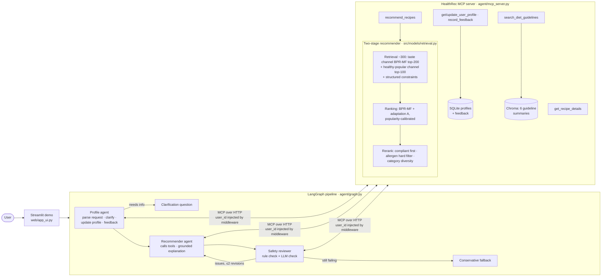
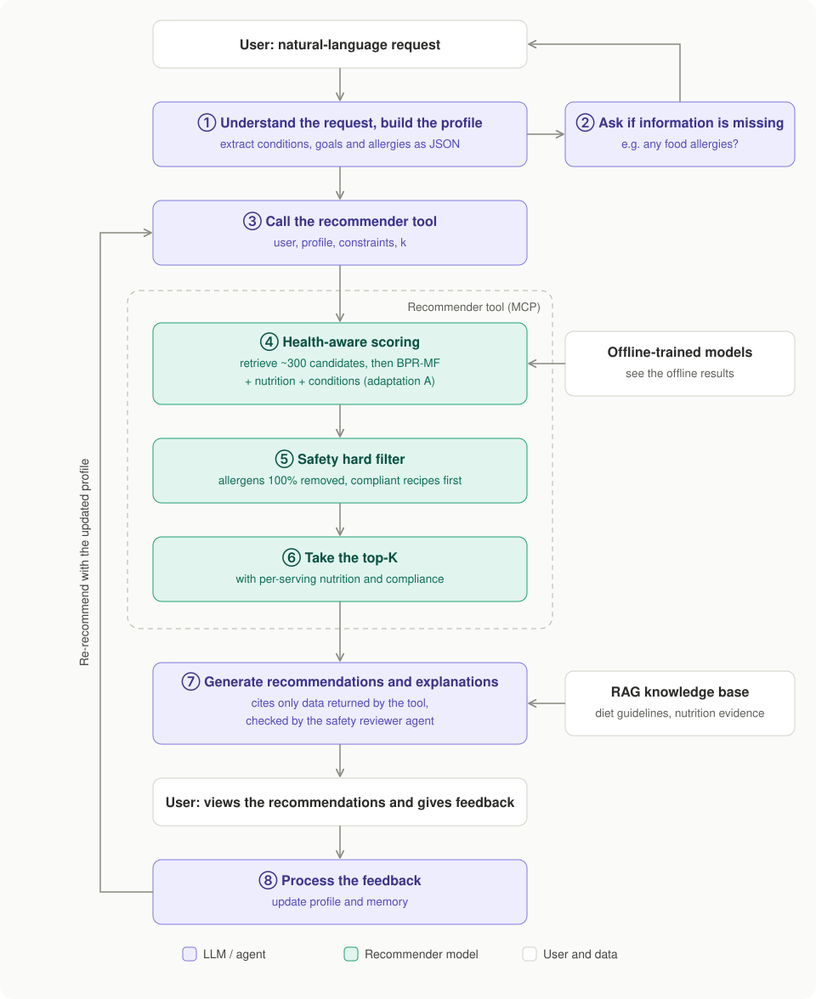

# HealthRec — a health-aware recipe recommender agent for chronic-disease diets

CA6124 group project (healthcare recommender systems). This portfolio copy preserves the team project; it does not claim sole authorship by any individual contributor.

**Contents:** [Objective](#project-objective) · [Architecture](#system-architecture) ·
[Installation](#installation-and-environment-setup) · [Data](#dataset-preparation) · [Training](#training-and-tuning) ·
[Reproduction](#reproducing-the-main-experiments) · [Demo](#running-the-demo) · [Results](#main-results) ·
[Repository](#repository-structure) · [Limitations](#limitations) · [References](#references)

---

## Project objective

> We develop a conversational recipe recommender for people with chronic conditions (type 2 diabetes,
> hypertension, hyperuricemia/gout). It balances **taste** learned from rating history with
> **guideline-based nutritional constraints and food allergies**, explains its suggestions with real
> nutrition data, and adapts to user feedback over several turns.

A general recipe recommender optimises taste only (on our data, 55–58 % of its top-10 recipes violate the
user's conditions). A general LLM assistant knows nutrition but not the user's taste, and invents recipes and
nutrition numbers that cannot be checked. HealthRec combines a trained recommender (for taste, grounded
recipes and exact nutrition) with LLM agents (for conversation, clarification, explanation and safety review).

---

## System architecture



### Online interaction flow



In the evaluation, a recommendation turn made 4–8 LLM calls (9–21 k tokens, 11–23 s with `qwen3.8-max-0902`); steps ④–⑥ take about
30 ms. `user_id` in every tool call is set by the middleware, never by the LLM.

| Component | What it does | Where |
|---|---|---|
| Health labels | Per-serving guideline thresholds (ADA, ACC/AHA 2017, ACR 2020, UK FoP labels) and 9 allergen groups, scanned in ingredient names, recipe name and cooking steps | `configs/health_rules.yaml`, `src/data/health.py` |
| BPR-MF | Rendle et al. (2009), own PyTorch implementation, fresh negatives every epoch, optional item bias | `src/models/bpr_mf.py` |
| **Adaptation A** (adopted) | item = ID + W·nutrition features; user = ID + Σ condition embeddings | `src/models/health_bpr.py` |
| Adaptation B (ablation) | health pairwise loss L = L_BPR + λ·L_health — tested, not adopted | `src/models/health_bpr.py` |
| Two-stage recommender | retrieval (2 channels + constraints) → ranking (A, popularity-calibrated) → safety rerank; cold-start users ranked by popularity among safe recipes | `src/models/retrieval.py` |
| Agents | profile → recommender → safety reviewer (fixed order, no LLM router), structured outputs, per-request context | `agent/graph.py`, `agent/middleware.py` |
| Multi-user memory | profiles + feedback in SQLite, per-user conversation memory; `user_id` forced by middleware | `agent/profile_store.py`, `agent/state_manager.py` |
| RAG | 6 diet-guideline summaries, query rewriting → multi-path retrieval → self-reflection | `data/guidelines/`, `rag/` |
| Guardrails | LLM input moderation + PII redaction | `agent/guardrails.py` |

---

## Installation and environment setup

All commands are run from the repository root. Tested on macOS (Apple M4, CPU only) with Python 3.12; Linux
works the same way; on Windows use WSL. No GPU is needed (full data: ~4 GB free disk, ~4 GB RAM).

| To … | you need |
|---|---|
| run the quick check on the bundled sample | only the environment (this section) |
| reproduce the offline results or the agent-evaluation tables | + the Kaggle dataset (free Kaggle account, see [Dataset preparation](#dataset-preparation)) |
| run the demo (or re-run the agent dialogs) | + your own DashScope API key (see [API key and models](#api-key-and-models)) |

### Code and environment (~5 min)

This public portfolio copy excludes credentials. Use your own API key for the online agent demo.

```bash
git clone https://github.com/jellooooo124/HealthRs.git   # or: git@github.com:jellooooo124/HealthRs.git
cd HealthRs
conda env create -f environment.yml          # creates "ca6124_healthrec" (Python 3.12, CPU PyTorch, pinned versions)
conda activate ca6124_healthrec
```

Without [Conda](https://docs.conda.io/): `python3.12 -m venv .venv && source .venv/bin/activate && pip install -r requirements.txt`.

### API key and models

The agents, the demo and the RAG index need an Alibaba Cloud Model Studio (DashScope) API key; the offline
recommender pipeline does not. No API keys are distributed with this public copy. Create a local `.env` from the template and supply your own credentials:

```bash
cp .env.example .env
```

Never commit `.env` or other credential files. The offline pipeline works without an LLM API key.

* `DASHSCOPE_API_KEY` — your Model Studio key.
* `DASHSCOPE_BASE_URL` — keep `https://dashscope.aliyuncs.com/compatible-mode/v1` for a mainland-China account;
  use `https://dashscope-intl.aliyuncs.com/compatible-mode/v1` for an international account.
* Model names are in `configs/agent_config.yaml` (section `llm`, one line each): agents `qwen3.8-max-0902` with
  automatic fallback to `qwen3.8-max`, then `qwen3.8-flash`, when a call fails (demo only; the formal evaluation is pinned to
  `qwen3.8-max-0902` without fallback), simulated user `deepseek-v4.1-flash`, judge `kimi-k3`, embeddings
  `qwen3.7-text-embedding-flash`. If your account cannot use these models (error *model not found* /
  *access denied*), set any chat model with tool calling and any embedding model available to you. Other
  OpenAI-compatible providers work too: set `DASHSCOPE_BASE_URL` and the model names.

---

## Dataset preparation

**Full data (for the report's numbers and the demo).** Download *Food.com Recipes and Reviews* by irkaal from
<https://www.kaggle.com/datasets/irkaal/foodcom-recipes-and-reviews> (button *Download*, unzip) and place the two
CSV files as

```
data/raw/foodcom/recipes.csv   (~670 MB)
data/raw/foodcom/reviews.csv   (~470 MB)
```

With the Kaggle command-line tool instead (needs a Kaggle API token in `~/.kaggle/kaggle.json`):

```bash
pip install kaggle
kaggle datasets download -d irkaal/foodcom-recipes-and-reviews -p data/raw/foodcom --unzip
```

Then build `data/processed/` and the dataset statistics:

```bash
python scripts/prepare_data.py   # ~2 min: cleaning, health labels, 5-core, temporal split, synthetic profiles -> data/processed/
python scripts/data_report.py    # dataset statistics tables and figures -> outputs/tables, outputs/figures
```

`prepare_data.py` prints nothing for about 1.5 min while it scans 520 k recipes. Success: a line
`[k-core] {'users': 19455, 'items': 45926, 'interactions': 636391, ...}` and a final `done in … s`.

Processing: nutrition outliers removed (0 kcal, > 5000 kcal/serving, sodium > 99.9th percentile); ratings
≥ 4 are positives, 0-star reviews are dropped, 1–3 are excluded from negative sampling; 5-core on positives
(19,455 users, 45,926 recipes, 636,391 interactions); temporal leave-one-out (last positive = test,
second-to-last = validation); 3,000 users outside the 5-core form the cold-start test set. Health profiles are
**synthetic** (fixed seed): conditions drawn with US prevalence (CDC/NHANES), allergies drawn with adult
prevalence (Gupta et al. 2019) and only assigned if none of the user's liked recipes contains the allergen.
No real patient data is used. Statistics: [`outputs/tables/dataset_stats.md`](outputs/tables/dataset_stats.md).

**Small sample (no download).** `data/sample/` holds a ~500-user extract in the original Kaggle format
(built by `scripts/make_sample.py`); `bash scripts/reproduce.sh --sample` runs the whole offline pipeline on it
(see [Reproducing the main experiments](#reproducing-the-main-experiments)). Its numbers are not comparable to
the report.

---

## Training and tuning

```bash
python scripts/train.py --name my_run --set train.dim=32 train.reg=0.01 train.item_bias=true health.use_features=true
python scripts/run_grid.py --grid configs/grids/step4_tune.yaml --jobs 4     # parallel runs, 2 threads each
```

Every key of `configs/model.yaml` can be overridden with `--set`. Each run writes
`outputs/runs/<name>.json` (config, per-epoch history, validation and test metrics) and
`outputs/checkpoints/<name>.pt`. Early stopping on validation NDCG@10. Model selection rule: highest validation
NDCG@10 among configurations with validation coverage@10 ≥ 1 % (configurations below collapse into "everyone gets
the same popular recipes"). `configs/grids/step3_*.yaml` are the exploratory grids (their run summaries are in `outputs/runs/`; they
predate the allergen-label fix, so only their accuracy columns are comparable); `step4_tune.yaml` is the
equal-budget grid used for the reported results.

---

## Reproducing the main experiments

| | What it verifies | Needs | Time | Command |
|---|---|---|---|---|
| 1 | The whole offline pipeline runs (sample shipped in the repo) | nothing | ~1 min | `bash scripts/reproduce.sh --sample` |
| 2 | **Every offline number in the report** is reproduced from raw data | Kaggle data | ~40 min | `bash scripts/reproduce.sh --full` |
| 3 | The agent-evaluation tables are recomputed from the logged dialogs | `data/processed/` | ~1 min | `bash scripts/reproduce.sh --agent-eval` |

### 1 · Quick check, no download (~1 min)

```bash
bash scripts/reproduce.sh --sample
```

Runs data processing, statistics, tuning, training (3 seeds) and the complete offline evaluation on
`data/sample/` (~500 users in the original Kaggle format). Success: the last line is
`Done. Results: outputs_sample/tables/ and outputs_sample/figures/` (19 tables, 8 figures). Sample numbers are
not comparable to the report.

### 2 · Full reproduction of the offline results (~40 min)

```bash
bash scripts/reproduce.sh --full
```

Needs `data/raw/foodcom/` (see [Dataset preparation](#dataset-preparation)). Rebuilds `data/processed/`,
re-computes the dataset statistics, re-runs the tuning grid (16 runs), trains the selected BPR-MF, A and A+B models
with 3 seeds, and re-computes every offline table and figure (test tables, trade-off sweep, ablation, cold start,
retrieval recall, popularity calibration) in a fresh `outputs_reproduced/`. It then compares them with the
committed results (`scripts/check_reproduction.py`): every metric cell of every table (timing columns such as
latency are skipped, as they depend on the machine) and the weights of the two serving models. Success: the last
line is `REPRODUCTION OK`. On our machine all metrics and model weights were bit-identical; on different hardware,
floating-point differences can cause tiny deviations — the affected tables are then marked `CHECK` with their
relative difference. The individual stages are `python scripts/run_offline.py --stage {tune,select,final,eval,blend}`.

### 3 · Agent-evaluation tables (~1 min)

```bash
bash scripts/reproduce.sh --agent-eval
```

Needs `data/processed/` (`python scripts/prepare_data.py`). The 49 simulated-user dialogs, judge scores and blind
human ratings are committed in `outputs/agent_eval/final/`. This recomputes
[`outputs/tables/agent_eval_final.md`](outputs/tables/agent_eval_final.md) (metrics, Wilcoxon tests, judge–human
agreement) without any API call.

**Re-running the agent evaluation** (requires an API key and about 0.5 M tokens; the committed logs make
re-running unnecessary):

```bash
python scripts/run_agent_eval.py --run final --role eval --configs full llm_only no_reviewer no_clarify
python scripts/run_agent_eval.py --run final --stage judge
python scripts/run_agent_eval.py --run final --stage report      # tables, Wilcoxon tests
python scripts/run_agent_eval.py --run final --stage agreement   # judge vs blind human ratings
```

All dialogs (`dialogs.jsonl`), judge scores (`judge.jsonl`), scenarios, token ledger and the human check
(`human_check_blind.md`, `human_check.csv`) are in `outputs/agent_eval/final/`. Runs use temperature 0, cache
every LLM call in `outputs/agent_eval/llm_cache.sqlite`, log tokens per model and stop at a token budget.

---

## Running the demo

Needs `data/processed/` ([Dataset preparation](#dataset-preparation)) and your own API key in a local `.env`
(see [API key and models](#api-key-and-models)); about 3 min to start.

```bash
python scripts/build_rag.py               # once, a few seconds: embeds data/guidelines/ into data/chroma_db/
streamlit run web/app_ui.py               # then open http://localhost:8501
```

The first answer takes ~10 s longer: the recommender MCP server (`python -m agent.mcp_server`, port 8765) is
started automatically in the background and loads the committed models (`outputs/checkpoints/`), so no training
is needed; its log is `outputs/logs/mcp_server.log`. Stop the demo with `Ctrl+C`; the recommender service keeps
running for the next start (stop it with `lsof -ti tcp:8765 | xargs kill`).

**What to try.**

1. User *Diabetes + peanut allergy · loves cookies* → **Something sweet that is still OK for me**: desserts that
   meet the diabetes limits and contain no peanuts, each with nutrition and a ✅ compliance badge.
2. Reply *I don't want frosting, maybe cookies?* — the feedback is stored and the frosting recipe is excluded;
   👍/👎 on a card (the selected button turns red; click again to undo) does the same.
3. Expand **How this answer was made** — the agents, tool calls, reviewer verdict, LLM calls and tokens.
4. **How much sodium per day is OK for me?** — answered from the diet-guideline RAG, citing the source file.
5. **➕ New user (cold start)** → *dinner ideas* — the assistant first asks about conditions and allergies, stores
   the answer in the profile and then recommends.

The sidebar switches between six Food.com users with synthetic health profiles (or a new / any other user),
shows and edits the profile, lists feedback, clears a conversation (with confirmation) and lets you add a guideline
document to the knowledge base. Conversations, recipe cards and traces are kept per user across restarts.

**Command-line checks** (no browser):

* `python scripts/demo_recommend.py --taste f_bpr_s2026 --health f_hA_s2026` — recommender only, **no API key**:
  recommendations for a warm user, an allergic user and cold-start users, with latency.
* `python scripts/agent_smoke_test.py` — five scripted multi-turn dialogs through all agents (API key, ~50 k tokens).
* `python scripts/agent_isolation_test.py` — a user cannot read or change another user's profile, concurrent
  users stay isolated (API key).

### Troubleshooting

| Symptom | Fix |
|---|---|
| `conda: command not found` | run `source <your-conda-dir>/bin/activate` (e.g. `~/miniconda3/bin/activate`) first |
| `Missing data. Download …` from `reproduce.sh` | put `recipes.csv` and `reviews.csv` in `data/raw/foodcom/` ([Dataset preparation](#dataset-preparation)) |
| `FileNotFoundError: …/data/processed/…` | run `python scripts/prepare_data.py` ([Dataset preparation](#dataset-preparation)) |
| `DASHSCOPE_API_KEY / DASHSCOPE_BASE_URL missing` | `.env` is missing or was overwritten: restore it with `git checkout .env` |
| `401` / *invalid API key* | check the key and that `DASHSCOPE_BASE_URL` matches your account region |
| *model not found* / *access denied* | change the model names in `configs/agent_config.yaml` ([API key and models](#api-key-and-models)) |
| demo answers *MCP server did not start* or uses old code | another copy is using port 8765: `lsof -ti tcp:8765 \| xargs kill`, then restart |
| port 8501 already in use | `streamlit run web/app_ui.py --server.port 8502` |

---

## Main results

**Offline (test split, temporal leave-one-out, full ranking over 45,926 recipes, mean ± std over 3 seeds)**

| Method | NDCG@10 | Recall@10 | Violation@10 | Allergen@10 | Coverage@10 |
|---|---|---|---|---|---|
| MostPop | 0.0113 | 0.0225 | 56.4 % | 0.9 % | 0.1 % |
| HealthyPop (most popular among compliant recipes) | 0.0094 | 0.0178 | 0 % | 1.2 % | 0.1 % |
| BPR-MF | 0.0099 ± 0.0004 | 0.0200 ± 0.0007 | 58.2 % | 2.4 % | 2.7 % |
| BPR-MF + post-filter | 0.0082 ± 0.0004 | 0.0165 ± 0.0006 | 0 % | 0 % | 2.9 % |
| BPR-MF + A + popularity calibration (no health rerank) | **0.0118 ± 0.0002** | **0.0235 ± 0.0003** | 55.0 % | 1.6 % | 3.3 % |
| **Ours: A + popularity calibration + health rerank + allergen filter** | **0.0096 ± 0.0000** | **0.0188 ± 0.0003** | **0 %** | **0 %** | **3.5 %** |

* Adaptation A (nutrition features + condition embeddings) beats MostPop (+4 %) once calibrated with item popularity.
* With zero guideline violations and zero allergens, our system is the most accurate method
  (+2 % vs HealthyPop with 27× its coverage, +16 % vs BPR-MF + post-filter).
* Ablation: removing the health rerank raises violations from 0 % to 54 %; removing the allergen filter
  raises allergen exposure from 0 % to 2.2 %; adding the health loss B *lowers* accuracy (reported as a negative result).
* Full tables: [`outputs/tables/offline_results.md`](outputs/tables/offline_results.md) ·
  trade-off curve: [`outputs/figures/offline_tradeoff.png`](outputs/figures/offline_tradeoff.png).

**Agent (simulated users, 15 scenarios × ≤3 turns, agent model qwen3.8-max-0902 at temperature 0)**

| | Full system | Pure-LLM agent | No safety reviewer | No clarification (cold-start, n=4) |
|---|---|---|---|---|
| Recommended recipes violating the user's conditions | **0 %** | not verifiable (no ids) | 0 % | 52 % |
| Recipe name/id mismatches reaching the user | 0 | – | 1 | 0 |
| Judge faithfulness (1–5) | **4.33** | 3.00 (p = 0.001) | 4.47 | 4.25 |
| Judge safety (1–5) | **5.00** | 4.53 (p = 0.008) | 5.00 | 2.25 |
| Judge overall (1–5) | 4.13 | 3.80 (p = 0.10) | 4.27 | 2.75 |
| Tokens / latency per turn | 9.9 k / 12.8 s | 4.9 k / 11.1 s | 7.2 k / 7.0 s | 9.5 k / 10.0 s |

Simulated user: deepseek-v4.1-flash; judge: kimi-k3 (three vendors to avoid self-preference). The judge was
validated against blind human ratings on 12 dialogs (quadratic weighted κ: faithfulness 0.77, safety 0.86,
overall 0.86; relevance 0.38 — not validated). Details: [`outputs/tables/agent_eval_final.md`](outputs/tables/agent_eval_final.md).

---

## Repository structure

```
agent/            LangGraph pipeline, MCP server/client, middleware, profile store, guardrails, LLM wrapper
rag/              guideline vector store (Chroma) and agentic RAG
web/app_ui.py     Streamlit demo
src/data/         loading/cleaning Food.com, health labels, preprocessing, synthetic profiles
src/models/       BPR-MF, health-aware BPR-MF (A/B), trainer, two-stage recommender
src/eval/         offline metrics, pipeline evaluation, agent evaluation (scenarios, simulator, judge)
scripts/          prepare_data, data_report, train, run_grid, run_offline, run_agent_eval, build_rag,
                  reproduce.sh, make_sample, check_reproduction, demo/smoke/isolation tests
configs/          data, model, health rules (with sources), agent/LLM settings, prompts, tuning grids
data/guidelines/  diet-guideline summaries for RAG        data/sample/  small sample in Kaggle format
outputs/          tables/, figures/, runs/ (run summaries), checkpoints/ (2 serving models), agent_eval/final/
```

---

## Limitations

* **Synthetic health profiles.** Conditions and allergies are simulated with population prevalence and are
  independent of taste; condition embeddings therefore cannot improve cold-start accuracy (our cold-start value
  is safety, not accuracy).
* **Rule-based health labels.** Per-serving thresholds approximate guidelines written per day or per meal;
  Food.com nutrition values are user-entered; ingredient lists are incomplete (we also scan cooking steps).
* **Strong popularity effect.** Under temporal leave-one-out most test items are popular; MostPop is a strong
  baseline and absolute accuracy is low for all methods.
* **Agent evaluation.** 15 scenarios (4 cold-start), LLM-simulated users that accept easily (task success
  100 % for all configurations), LLM judge validated on 12 dialogs (relevance not validated). After the
  evaluation the reviewer's facts were extended with `complies_with` to avoid one observed false rejection.
* **Not medical advice.** The system supports, but does not replace, a doctor or registered dietitian.

---

## References

* S. Rendle, C. Freudenthaler, Z. Gantner, L. Schmidt-Thieme. BPR: Bayesian Personalized Ranking from Implicit Feedback. *UAI* 2009.
* Food.com Recipes and Reviews, Kaggle dataset by irkaal.
* American Diabetes Association. Standards of Care in Diabetes (nutrition therapy); carbohydrate counting.
* P. K. Whelton et al. 2017 ACC/AHA Guideline for the Prevention, Detection, Evaluation, and Management of High Blood Pressure in Adults. *Hypertension* 71(6), 2018.
* J. D. FitzGerald et al. 2020 American College of Rheumatology Guideline for the Management of Gout. *Arthritis Care & Research* 72(6), 2020.
* UK Department of Health / FSA. Guide to creating a front of pack (FoP) nutrition label for pre-packed products sold through retail outlets, 2016.
* WHO. Guideline: Sugars intake for adults and children, 2015; Healthy diet fact sheet.
* R. S. Gupta et al. Prevalence and severity of food allergies among US adults. *JAMA Network Open* 2(1), 2019.
* M. Chen-Xu et al. Contemporary prevalence of gout and hyperuricemia in the United States, NHANES 2007–2016. *Arthritis & Rheumatology* 71(6), 2019.
* M. Ferrari Dacrema, P. Cremonesi, D. Jannach. Are We Really Making Much Progress? A Worrying Analysis of Recent Neural Recommendation Approaches. *RecSys* 2019.
